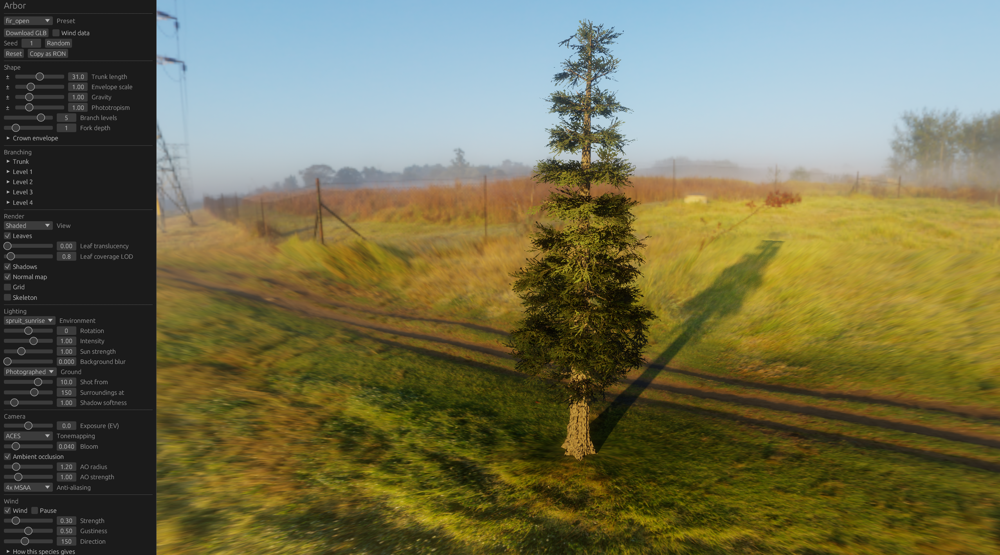

# Arbor - Flora generation tool

Procedural tree model generator, written in Rust. Aim is to generate ~7k-20k tri models.
It also makes the things that grow and lie around trees: shrubs, climbing and
trailing vines, ground cover (grasses, wildflowers and ferns) and rocks.

